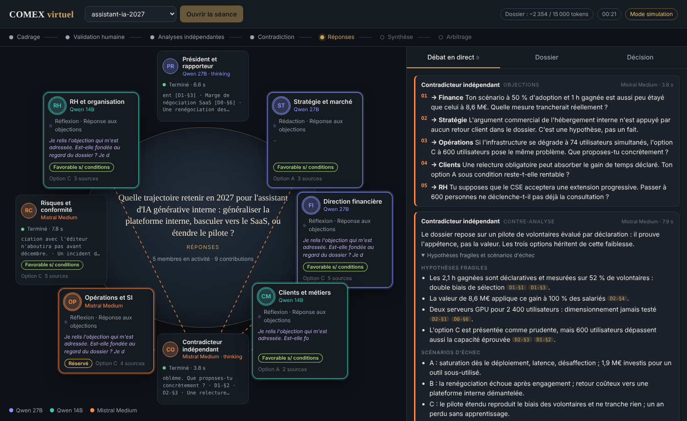

# COMEX virtuel, version 1

Huit agents (président, six experts, un contradicteur) analysent une question stratégique
à partir d'un dossier documentaire, selon un protocole borné, sous le contrôle d'un décideur humain.
L'interface « salle du COMEX » montre chaque agent au travail en temps réel.



COMEX **consultatif** : il prépare un arbitrage, il ne décide pas.

## Démarrage rapide (mode simulation, sans modèle)

```bash
pip install -r requirements.txt
python -m uvicorn app.server:app --port 8000
```

Ouvrez http://localhost:8000, choisissez `assistant-ia-2027`, cliquez **Ouvrir la séance**.
En mode simulation, les réponses sont préenregistrées pour le dossier d'exemple : c'est fait pour
vérifier l'interface et le protocole, pas pour juger la qualité des analyses.

## Brancher vos modèles Ollama (PowerShell)

Les deux modèles sont configurés dans `config.yaml` sur `http://localhost:11434/v1`,
avec une clé API vide :

- `gpt-oss:120b-cloud`
- `gemma4:31b-cloud`

1. Avec Ollama démarré, vérifiez les modèles exposés :

```powershell
(Invoke-RestMethod -Uri "http://localhost:11434/v1/models").data | Select-Object id
```

2. Activez les appels réels et lancez l'application dans la même session PowerShell :

```powershell
$env:COMEX_MODE = "reel"
python -m uvicorn app.server:app --port 8000
```

Les URL sont déjà renseignées dans `config.yaml` : aucune variable `QWEN27_URL`,
`QWEN14_URL`, `MISTRAL_URL` ni clé API n'est nécessaire. Si Ollama tourne sur une autre
machine ou un autre port, modifiez les champs `base_url` dans ce fichier.

La répartition des agents sur les modèles se change dans `config.yaml` (section `agents`), sans toucher au code.

Pour revenir à la simulation, définissez `$env:COMEX_MODE = "simulation"` puis relancez l'application.

## Le protocole d'une séance

1. **Cadrage** : le président reformule la question, les options, les critères et les inconnues.
2. **Validation humaine** : la séance s'arrête. Vous validez, ou apportez des précisions et demandez un nouveau cadrage.
3. **Analyses indépendantes** : les six experts et la contre-analyse du contradicteur tournent en parallèle,
   **sans voir les avis des autres**.
4. **Contradiction** : le contradicteur lit tous les avis et adresse des objections ciblées.
5. **Réponses** : chaque expert visé maintient, ajuste ou concède.
6. **Synthèse** : le président restitue options, accords, désaccords persistants et une recommandation conditionnelle.
7. **Arbitrage** : vous saisissez votre décision ; le compte rendu Markdown est téléchargeable.

Chaque contribution est attribuée, horodatée, liée au modèle qui l'a produite, et jamais réécrite.
Les références citées (`[D1-§2]`) sont vérifiées : une référence inventée apparaît barrée en rouge.

## Créer un nouveau dossier

1. Créez un répertoire dans `seances/`, par exemple `seances/cloud-souverain/`.
2. Copiez `docs/gabarit_00_question.md` en `00_question.md` et remplissez-le.
3. Ajoutez vos documents en Markdown (`01_...md`, `02_...md`). Pour convertir des PDF ou des Word :
   `pip install markitdown` puis `markitdown rapport.pdf > 01_rapport.md`.
4. Chaque titre de niveau 2 (`## …`) devient une section citable. Les fichiers commençant par `_` sont ignorés.

Budget : le compteur de l'en-tête estime la taille du dossier. Restez sous 15 000 tokens pour laisser
la place aux instructions et aux réponses avec un contexte de 32K.

## Structure

```
config.yaml            modèles, répartition des agents, protocole
app/agents.py          mandats des membres, schémas JSON des contributions, prompts
app/graph.py           graphe LangGraph : le protocole de séance
app/llm.py             appels vLLM en streaming (thinking, sortie structurée, reprise) et simulation
app/dossier.py         chargement et numérotation du dossier, vérification des sources
app/runtime.py         journal d'événements par séance (rejouable après déconnexion)
app/server.py          API FastAPI et flux SSE
app/rapport.py         compte rendu Markdown
app/simulation.py      réponses préenregistrées du dossier d'exemple
static/index.html      interface (sans étape de build)
seances/               dossiers de séance ; les comptes rendus sont écrits dans <dossier>/resultats/
```

## Dépannage

| Symptôme | Piste |
|---|---|
| Erreur 400 ou réponses vides avec la sortie structurée | Mettre `sortie_structuree: consigne` dans `config.yaml` |
| Un agent en erreur « non conforme au format JSON » | Augmenter `max_tokens` (le mode thinking consomme des tokens) |
| Agents du 14B tronqués | Dossier trop long pour `contexte_max` : le résumer |
| Rien ne s'affiche en direct derrière un proxy | Désactiver la mise en tampon pour `/api/seances/*/evenements` |

## Limites de cette version

- Séances conservées en mémoire : un redémarrage les efface (les comptes rendus restent sur disque).
  Pour reprendre une séance, remplacer `InMemorySaver` par `SqliteSaver` ou `PostgresSaver` dans `app/graph.py`.
- Un seul utilisateur, pas d'authentification : à placer derrière votre reverse proxy et votre SSO.
- Le dossier entier est injecté dans chaque prompt. Au-delà du budget de contexte, il faudra ajouter
  le résumé par document ou un outil `lire_section`.
- Avant d'adopter l'outil, comparer ses résultats à ceux d'un agent unique bien guidé sur les mêmes questions.
